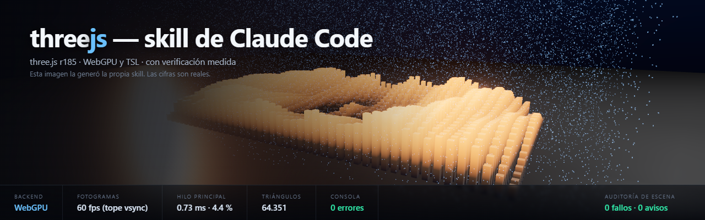

# threejs — skill de Claude Code para three.js r185

Una **Agent Skill** que enseña a Claude Code a escribir three.js moderno, a no
reinventar lo que la librería ya trae, y a **verificar lo que construye** en
lugar de darlo por bueno.

## El problema que resuelve

Un agente ya sabe escribir three.js. Lo que no sabe de fiar es **qué API sigue
viva**. Su salida por defecto es three.js de alrededor de 2023:

```js
const renderer = new THREE.WebGLRenderer();   // superado por WebGPURenderer
const clock = new THREE.Clock();              // @deprecated desde r183
requestAnimationFrame(animate);               // rompe WebXR y WebGPU
new EffectComposer(renderer);                 // el catálogo TSL hace mucho más
```

Las cuatro líneas funcionan, avisan por consola y nadie mira la consola. Esta
skill fija el canon de r185 y obliga a comprobarlo.

## Qué incluye

| | |
|---|---|
| `SKILL.md` | Router: canon r185, reglas duras y tabla de banderas rojas |
| `references/capabilities.md` | Mapa de lo que ya trae la librería, para no reimplementarlo |
| `references/canon-r185.md` | Renderer, importmap, espacios de color, escala, disposal |
| `references/deprecated-r185.md` | Lista negra sacada de las 84 anotaciones `@deprecated` del fuente |
| `references/tsl-language.md` | Three.js Shading Language: nodos, `Fn`, control de flujo, compute |
| `references/postfx-catalog.md` | Los 45 ficheros de post-proceso TSL (47 exports), con orden y coste medido |
| `references/environments.md` | Cielo, agua, terreno, niebla, iluminación, escala planetaria |
| `references/geometry-procedural.md` | `BufferGeometry`, instancing, `BatchedMesh`, LOD |
| `references/animation-motion.md` | `Timer`, mixer, cámaras, movimiento en shader |
| `references/web-integration.md` | Canvas en una página real: scroll, móvil, accesibilidad |
| `references/pitfalls-production.md` | Fallos que no lanzan error y cuestan horas |
| `scripts/new_scene.mjs` | Genera una escena arrancable con el importmap correcto |
| `scripts/serve.mjs` | Servidor de desarrollo sin caché |
| `scripts/verify_scene.mjs` | Mide en Chrome real y audita el grafo de escena |

Las referencias se cargan **bajo demanda**: sólo `SKILL.md` entra en contexto
siempre. El coste real de una skill es contexto, no disco.

## Instalación en Claude Code

Las skills de ámbito de usuario viven en `~/.claude/skills/`. Clona el
repositorio directamente ahí con el nombre `threejs`:

```bash
git clone https://github.com/Picaresco/threejs-skill.git ~/.claude/skills/threejs
```

En Windows con PowerShell:

```powershell
git clone https://github.com/Picaresco/threejs-skill.git "$env:USERPROFILE\.claude\skills\threejs"
```

Reinicia Claude Code. La skill se activa sola en **cualquier proyecto** cuando
la conversación toca three.js, WebGL, WebGPU, TSL, glTF, shaders o similares.

Para instalarla sólo en un proyecto, clónala en `<proyecto>/.claude/skills/threejs`.

Comprobar que está cargada: `/skills` en Claude Code, o pedirle directamente
«usa la skill threejs».

### Requisitos

- **Claude Code** con soporte de Agent Skills.
- **Node.js 22 o superior** para los scripts (usan `fetch` y `WebSocket`
  nativos, sin dependencias).
- **Chrome o Edge** para `verify_scene.mjs`.
- `three@0.185.x` en el proyecto donde trabajes. Sin él, `new_scene.mjs`
  apunta a un CDN.

## Uso

### Crear una escena

```bash
node ~/.claude/skills/threejs/scripts/new_scene.mjs --dir escenas/mi-escena --title "Mi escena"
```

Sube por el árbol buscando `three` instalado y escribe el importmap con la ruta
relativa correcta para esa profundidad. Un importmap mal escrito falla como un
error de especificador que no dice nada útil.

### Servir y verificar

```bash
node ~/.claude/skills/threejs/scripts/serve.mjs --root . --port 8765
node ~/.claude/skills/threejs/scripts/verify_scene.mjs \
     --url http://127.0.0.1:8765/escenas/mi-escena/ --orbit 3 --json informe.json
```

Salida típica:

```
  backend      webgpu
  fps          mean 60  p50 60   [vsync-capped: read main-thread instead]
  main-thread  mean 1.38 ms  p95 1.83 ms   (8.3% of a 60 Hz budget)
  draw calls   142   triangles 65641
  errors       0   exceptions 0
  scene audit  40 drawables · 0 errors · 0 warnings
```

### Por qué mide así

- **En Chrome real, nunca headless.** Sin foco, Chrome limita
  `requestAnimationFrame` a ~1 fps: cualquier medida de fps es ficción.
- **El hilo principal manda, no los fps.** A 60 Hz una escena trivial y otra al
  borde del tartamudeo informan ambas 60. Los milisegundos de CPU por fotograma
  degradan de forma lineal y muestran el margen real.
- **Audita el grafo de escena**, porque una imagen incorrecta no lanza ningún
  error ni cuesta un milisegundo: orden de dibujo entre transparentes, domo de
  cielo dentro de la niebla, mapas de datos etiquetados como sRGB, frustum de
  sombra que no cubre la escena.

Funciona **sin que el proyecto coopere**: three.js anuncia cada `Scene` y cada
`Renderer` a `__THREE_DEVTOOLS__` en su constructor, y el arnés instala esa
global antes de que cargue la página. Exponer `window.__scene = { scene, camera,
renderer, controls }` es algo más fiable y cuesta una línea.

Opciones útiles: `--eval "<expresión>"` inspecciona la escena viva (admite
`async`), `--orbit N` captura desde N ángulos, `--keep-open` deja el navegador
abierto.

## De dónde salen las cifras

Las medidas, las tablas de coste y los hallazgos que citan las referencias no son
estimaciones: salen de
**[threejs-skill-testbed](https://github.com/Picaresco/threejs-skill-testbed)**,
un banco de pruebas con dos escenas en extremos opuestos de escala —1,2 m y
1100 m— porque es ahí donde los parámetros en unidades de mundo se equivocan, y
en direcciones distintas.

Ese repo guarda además las **capturas de cada hallazgo**, que es la única forma de
verlos: los diecisiete daban 0 errores, 0 excepciones y 0 hallazgos de audit. Las
bandas del AO, el halo de silueta, el velo del bloom y el recorte a 5× del MSAA
están ahí como PNG, junto al interruptor de query string que reproduce cada uno.

Si corriges algo de este skill, mídelo allí antes.

## Sobre la cabecera

No es una ilustración. La genera `assets/header-scene/`, una escena construida
con esta misma skill, y las cifras de su pie son las que midió
`verify_scene.mjs` en esa ejecución. Se regenera con las instrucciones de
`assets/header-scene/README.md`.

## Estado

Validada contra tres escenas construidas con ella y contra una página que no
expone nada. Cubre WebGPU y el camino de respaldo WebGL2.

Se irá ampliando.

## Licencia

MIT.
